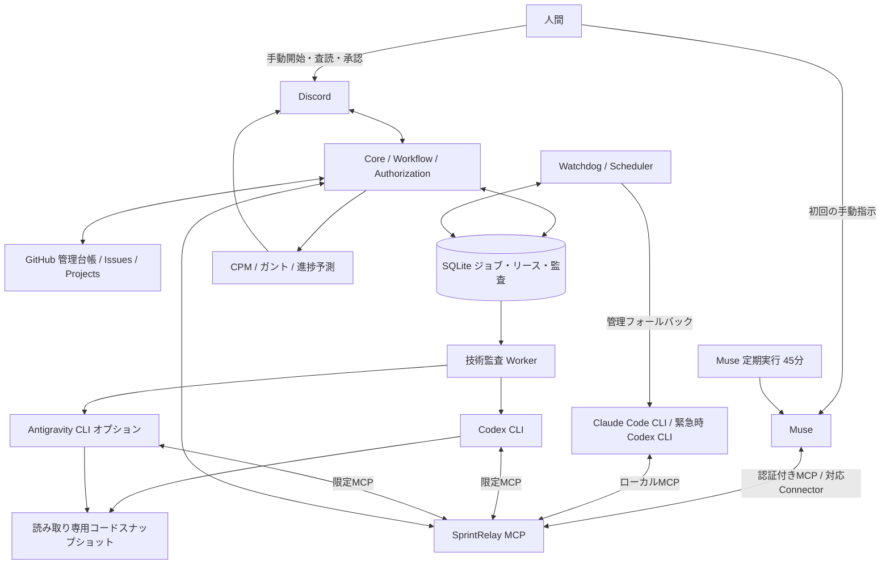
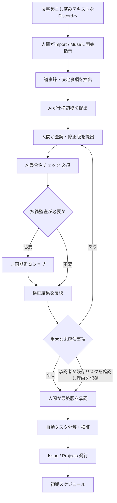
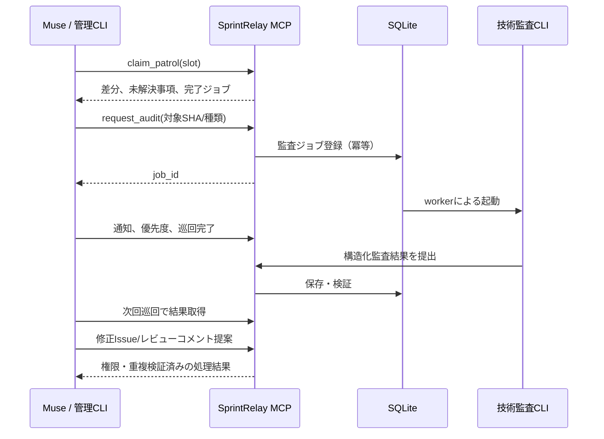
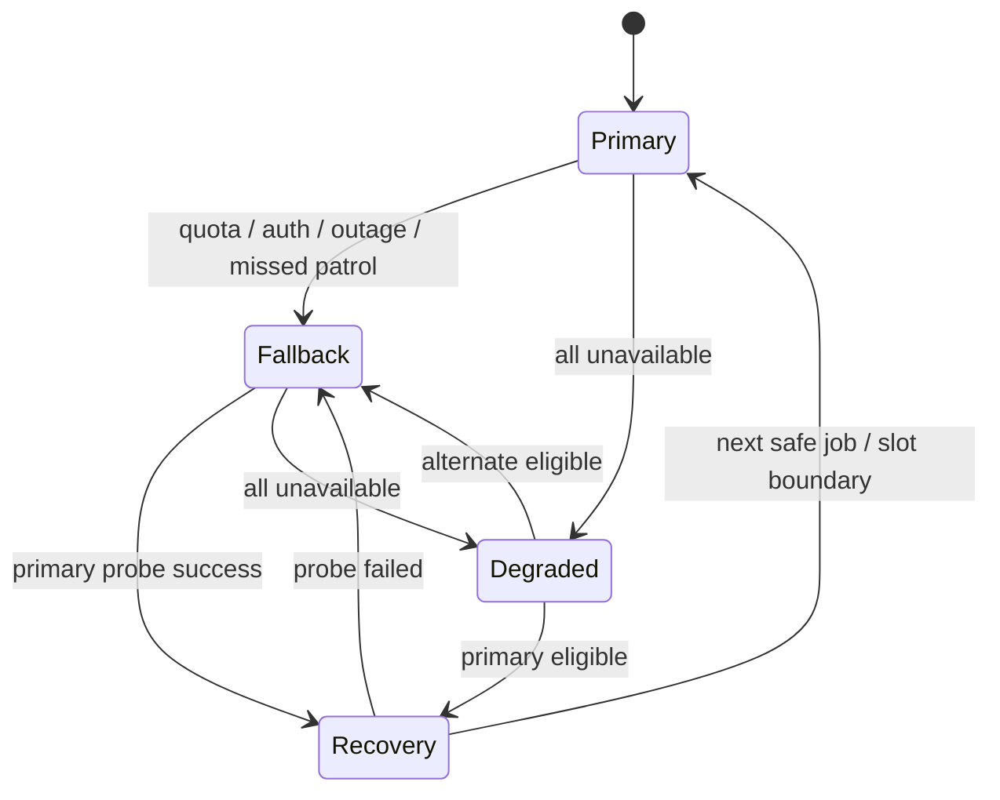

# SprintRelay v2 — MCP中心型AIチーム開発管理システム 改修仕様書

- 版: 2.0（実装指示書・2026-11-24）
- 対象: `sugimoto-blyukher/sprint-relay` の既存実装（調査時 main: `9547994a55139476755165c99da3e2179d41acec`）
- 想定利用: P2HACKS2026、および将来の5人程度の小規模チーム開発
- 実装担当: 開発用Codex。人間は仕様決定、査読、受け入れ、必要な小規模修正を担当する。
- 本書を旧 `sprint-relay-implementation.md` の後継仕様とする。旧仕様と矛盾する場合は本書を優先する。旧仕様の機能のうち、本書で明示的に変更しないものは維持する。

## 1. 目的と制約

優先順位は (1) 管理作業の省力化・開発効率向上、(2) 認識のズレ・作業衝突防止、(3) 進捗可視化、(4) AI管理の実践。自動化それ自体を目的にしない。人間の操作は初回会議処理の起動、仕様査読・修正・承認、重要な意思決定、各作業の実績・例外入力、初期認証と自動復旧不能時の対応に限定する。

### 絶対要件

- SprintRelayはLLM推論APIを直接呼ばない。OpenAI/Meta/Anthropic/Google等のモデルAPIキーを設定、要求、保持、転送しない。`.env.example` の `MODEL_API_KEY`, `OPENAI_API_KEY`, `AI_PROVIDER`, `MUSE_MODEL`, `CODEX_MODEL` など旧API経路の設定は削除または明確に移行する。CLIの任意モデル名設定は別項目とする。自動的な有料API課金への切り替えは禁止。
- AIは公式クライアントのアカウント認証を使用し、SprintRelayが提供するMCP toolsを呼ぶ。GitHub App/PAT（限定権限）、Discord Bot Token、SprintRelay MCPの認証情報はモデルAPIキーと区別し、集中管理する。
- 管理用AIはプロダクトのソースコードを変更しない。コミット、push、ブランチ作成、修正PR作成、マージ、任意コマンド実行は禁止。開発者が自分の裁量で使うAIと、SprintRelay本体を実装する開発用Codexにはこの運用上の制約を混同しない。
- GitHubを正式な仕様・タスク状態の管理基盤とし、Discordは操作・通知のインターフェースとする。ローカルSQLiteはワークフロー・ジョブ・同期・監査の補助情報に限定する。
- 重要な仕様・スコープ・担当変更・期限の変更は人間のみが決定する。AIは承認を捏造できない。
- AIが全停止してもタスク操作、同期、予定計算、可視化を継続する。再認証等を除き、自動Failover・自動Failbackを必須とする。
- ベンダーの認証方式・利用制限・利用規約を順守する。認証トークンの抽出、アカウントの共有、同一サービスの利用制限の回避、未公開APIの逆解析を行わない。

## 2. 全体アーキテクチャ



MCPはツール提供プロトコルであり、エージェントの起動や推論を行うものではない。MuseがCodex CLIを直接操作するのではなく、MCP toolに監査依頼を登録し、SprintRelayのworkerが非同期で公式CLIを起動する。CLIをMCPサーバーとして公開する必要はなく、管理・技術監査ともSprintRelayのMCPクライアントとして動作させる。

Linux（Proxmox VE LXCを想定）にモジュラーモノリスとして配置。Python 3.11以上、既存discord.py/Pydantic/Pillow、公式Python MCP SDK、SQLite、asyncioを基本にする。Redis/Celery/Kubernetes/独自Web UIは導入しない。CLI実行をBotのイベントループでブロックしない。必要な分離は別OSユーザー、別プロセス、隔離ワークスペース等で実現する。MCPリモート公開は認証付きHTTPS、ローカルCLIはstdioブリッジまたはループバックHTTPで共通Coreに接続する。stdioが別のDBやbotを立ち上げないこと。

## 3. 既存実装との関係と移行

調査時のmainには `relay/ai.py` の同期 `ResponsesClient`, `Provider`, `ManualProvider`, `MockProvider`、`relay/workflow.py` の `Workflow`、`relay/core.py` の `Task`/検証/状態遷移、`relay/schedule.py`、`relay/github.py`、`relay/bot.py`、`relay/changes.py`、`relay/config.py`、既存testsが存在する。

| 対象 | 方針 |
|---|---|
| `relay/ai.py` | ResponsesClientと直接推論API経路を撤去。既存のPydantic結果モデルは再利用可能。手動・mock経路は維持する。 |
| `relay/workflow.py` | draft/validate/tasksを外部エージェントへの非同期依頼に置換。版digest、査読、承認、冪等性を維持。 |
| `relay/core.py`, `relay/schedule.py`, `relay/changes.py` | 原則再利用。監査Issue、動的再計算、状態変更の権限とテストを追加。 |
| `relay/github.py`, `relay/bot.py`, `relay/discord_io.py` | 再利用し、認証、通知、ジョブの状況表示、同期・再試行を拡張。 |
| `relay/config.py`, `relay/__main__.py` | TOMLにagent/MCP/watchdog/security設定追加。CLI check/status/doctor等を追加。 |
| `tests/`, `.github/workflows` | 回帰テストを維持し、新仕様に対応するmockとテストを追加。 |
| README/AGENTS/docs/.env.example | 旧APIキーの説明を除去。新しい仕様、操作、認証、障害復旧を記載。 |

既存のGitHub台帳 `.sprint-relay/tasks.json` と `.sprint-relay/specs/` を正式データとして維持する。Issues/Projectsは同じ状態を表示・操作する入口。既存タスクID、Issue対応、仕様digest、承認記録、実績、ベースラインを変更しない。SQLiteはschema versionとトランザクション付きmigrationを用意し、事前バックアップ・復旧手順・dry-runを提供する。既存AI処理中のデータを勝手に承認せず、未完了ジョブとして再投入できるようにする。旧APIキーは読まず値をログに残さない。旧仕様ファイルを履歴として残す場合は superseded と明記する。

## 4. エージェントの構成

| 役割 | 優先順位 | 起動方法 |
|---|---|---|
| 管理 | Muse → Claude Code CLI（任意）→ Codex CLI（緊急時） | Muse側の手動指示・定期実行、CLIはSprintRelay worker |
| 技術監査 | Codex CLI → Antigravity CLI（任意） | SprintRelay workerの非同期起動 |
| 全候補停止 | Manual / Degraded | 既存手動ワークフローを維持 |

オプションはインストール、アカウント認証、利用条件、接続テストがすべて成立した場合のみ有効化。未導入・未検証のものはdisabled/unverifiedとして扱う。管理側と監査側のヘルスは独立。ただし同一アカウントの利用制限等のプロバイダー全体障害は共有する。Codex兼任時は共通の同時実行数1、管理ジョブと監査ジョブの循環待ちを禁止。管理ジョブが監査を依頼したら結果を待たず終了・再開できるようにする。

### 4.1 実行アダプター

- `AgentRegistry` は role/provider/capability/health を管理。 `CliAdapter` は起動引数、公式CLIバージョン確認、出力解析、エラー分類、タイムアウト、停止を担当。
- Codex: `codex exec`、Claude Code: `claude -p`、Antigravity: `agy -p` を候補とする。正確なフラグ、MCP設定、ログイン、JSON対応はインストールした版の公式文書・`--help`で検証し、対応版を記録する。存在しないフラグは作らない。必要な構造化データはMCPで提出し、CLI stdoutだけを成功判定にしない。
- CLIは認証済みの所有者が許可した利用環境で使用する。SprintRelayがOAuthトークンを取り出したり独自ログイン画面を作ったりしない。管理用の処理を不特定ユーザーの推論サービスとして提供しない。Claude Codeの個人サブスクリプションをチーム向け推論中継として使うことは規約上の制限があるため、自動実行の利用条件が明確になるまで無効とする。他CLIも利用形態を同様に確認する。
- MuseはクラウドのパーソナルAIエージェントでありMuse CodeやMuse Spark APIとは異なる。公式Custom Connectorで本MCP接続が利用可能か、定期実行で実際に認証付きtool callが可能か、45分周期、承認設定、実行時間、エラー動作を合成データで検証する。未確認の機能を実装済みと記載しない。接続方法が非対応ならMuseをunavailableとしてCLI側で動かす。モデルAPIで置き換えない。
- provider毎の設定手順と共通管理プロンプト・監査プロンプトを `docs/agents/` または同等の場所に配置。会話履歴に依存しない。モデルの名称や推論強度は利用者設定で任意、Astra固定を要求しない。

## 5. ユースケースA：議事録・仕様策定（手動開始）



- 外部で文字起こし済みの本文・UTF-8 txt/mdのみ。録音、文字起こし、音声APIは対象外。専用非公開チャンネルに投稿し、`/meeting import` 等で明示的に開始。投稿のみでは処理を開始しない。メッセージID/添付hashによる重複防止。入力サイズ上限（初期1 MiB、設定可）、形式チェック、参加者同意と許可された外部処理先を確認。
- Museへの開始指示は人間が行う。手動開始後のジョブ連鎖は自動。Museが不可ならCLI管理役へ引き継ぐ。巡回が未import会議を勝手に処理することは禁止。途中の人間待ち以外は必要な処理を自動継続し、Museのセッション継続不可時は次回巡回またはWatchdogが再開。未承認の版を自動公開しない。
- 議事録は会議ID、ソース参照、概要、明示的決定事項（根拠引用/発言位置）、提案、未決事項、決定理由、影響範囲を構造化する。推測を決定扱いしない。
- 初稿は目的、対象者、ユースケース、機能/非機能要件、安定した要件ID、インターフェース、担当、スコープ内外、受入条件、制約、未決事項をMarkdownで出力。
- Discordでファイルを受け取り、`/spec revise` に修正版mdと理由を提出する。GitHub上の人間編集も許可する場合は同じrevision登録を通す。初稿と人間修正版のdiffを保存。AIは用語統一、重複排除、誤字、意味を変えない明確化、承認済み内容からの条件補完だけを自律実行できる。API契約、機能、技術、スコープ、期限は提案のみ。
- 人間の査読・修正（変更なしの明示確認も可）の後、必ず同一revision digestに対するAI整合性検証を1回以上実施する。論理、技術、担当間、網羅性、期間・人員、決定事項との一致を確認。重大事項は差し戻す。軽微修正で内容が変わった場合は新digestを採番し、最終版に対する検証結果・diffを表示して承認を得る。
- 承認ボタン/コマンドは認可された人間だけ。承認を対象project、meeting、revision digest、validator結果、actor、日時に結びつける。古いボタン、差分変更、別会議の承認流用を拒否。AI経由で承認・権限昇格できない。
- 最終承認後は新規確認を要求せずタスク分解、構造検証、発行、初期計算を実行する。ただし重大な矛盾・循環依存・未知の要件/担当は停止して問題点を報告し、再生成または人間判断へ。

### ワークフローの状態

`IMPORTED → MINUTES_READY → DRAFT_READY → HUMAN_REVIEWED → VALIDATING → VALIDATED → APPROVED → PLANNING → PUBLISHING → PUBLISHED`。
重大指摘は `NEEDS_REVISION` へ、再査読から `VALIDATING` に戻る。例外として、承認者は査読・検証済みの現行 digest の指摘を確認し、理由付きで `NEEDS_REVISION` から `APPROVED` に進める。検証レポートと指摘を保存し、承認記録に強制承認フラグと理由を残す。技術監査待ちは `WAITING_AUDIT`。外部障害はジョブ側のretry状態で表現し、承認を消さない。仕様が変わるたび旧承認/検証を失効し、公開済みの旧版は履歴に残す。状態遷移はCoreのトランザクションで強制し、AI出力を信用しない。

## 6. ユースケースB：定期巡回



- Museのデフォルト巡回は45分、動的変更可能。新規/更新Issue・PR・CI、現在時刻による期限超過、残作業、未解消ブロッカー、未回収監査結果、保留中の承認済みワークフローを取得。差分ゼロでも時間経過と未解決事項を確認し、必要なら対応する。
- Muse側での定期実行設定は初回手動。SprintRelayは巡回スロットと期限を管理し、設定変更後にMuse側の周期変更が必要なら通知する。Museに外部起動APIがあることを前提にしない。CLIはWatchdogが設定周期で起動する。巡回間隔変更時にスロットを再設定する。
- 変更差分はGitHub cursor/snapshot IDと、永続化した最後の成功checkpointで管理。ページングや部分失敗で取りこぼさない。前回失敗分を再処理しても副作用を重複させない。
- AI判断不要のGitHub同期（既存poller再利用、webhookは任意）、状態変更に伴うスケジュール再計算、期限超過の定期検出、依存解消通知は巡回を待たず実施。ポーリング初期60秒（設定可）。
- PRは新規またはhead SHA変更時、CIは新たな失敗run/attempt、仕様は必要な技術的検証時に監査する。同一結果や既存Issueを照合して再依頼・通知乱発を防止。新たな重要情報や状態悪化だけを即時通知、その他はまとめる。
- Museは問題分析、提案、監査ジョブ依頼、修正Issue起票、既存PRへのレビューコメント、優先度調整を自動で行える。監査結果を参照し根拠・影響・修正条件を明記。完了、担当変更、既存作業内容変更、廃止、主要仕様、期限は人間のみまたは明示的な承認済みイベント。コード変更を伴わないSuggested Changesの提案は可、適用は人間。
- レビューコメントにはAI生成であること、対象SHA、根拠を示す。レビューのApproveやRequest Changesで人間のマージ判断を代替しない。古いSHAへのコメントはstaleにして再確認。重要度低・根拠なしは投稿しない。

## 7. MCPインターフェース契約

公式MCP SDKを使用。tools/list, tools/callを実装し、入力出力をPydantic/JSON Schemaで厳密に定義。role別のツール公開に加えて全callでサーバー側認証・認可・project scopeを確認する。`project_id`、revision、target、job IDはサーバー検証。任意URL、任意path、任意コマンド、任意SQL、汎用GitHub API proxyを提供しない。入力に含まれるactor/provider名を認証情報として信用しない。

| tool | 主要引数 → 結果 | 許可 |
|---|---|---|
| `get_project_context` | project → 固定チーム、制約、許可範囲 | 管理/監査 |
| `list_workflow_jobs` | cursor, kinds, limit → 処理可能なjob | 管理 |
| `claim_job` | job_id → lease_token, input_ref, deadline | 管理（許可されたjobのみ） |
| `heartbeat_job` | job_id, lease_token → lease期限 | 所有エージェント |
| `get_transcript` | job_id, lease_token → 同意済み本文、source | 管理 |
| `submit_minutes` | job/lease, structured minutes → artifact ID | 管理 |
| `get_specification` | meeting/revision/job → Markdown、digest | 管理/割当監査 |
| `submit_specification` | job/lease, markdown, evidence → revision digest | 管理 |
| `submit_validation` | job/lease, revision digest, findings, optional minor revision → 検証ID | 管理 |
| `submit_task_plan` | job/lease, approved digest, tasks → validation/publish status | 管理 |
| `claim_patrol` | slot ID または current → lease, snapshot cursor | 管理 |
| `get_patrol_delta` | patrol lease, cursor → 差分、期限、未解決、完了監査 | 管理 |
| `get_tasks` | area/status/cursor/limit → tasks | 管理/監査 |
| `get_schedule` | project → baseline、forecast、CPM、risk | 管理/監査 |
| `get_progress` | project → 集計、blockers | 管理/監査 |
| `request_audit` | kind, repo, target/ref, bounded question → job ID, dedup status | 管理 |
| `get_audit_status` | job_id → state, timestamps | 管理/割当監査 |
| `get_audit_context` | job/lease → bounded read-only context, pinned SHA | 割当監査 |
| `submit_audit_result` | job/lease, findings → result ID | 割当監査 |
| `get_audit_result` | job_id → 構造化結果 | 管理 |
| `propose_or_create_issue` | result/finding ID, target, task plan → action receipt | 管理 |
| `post_review_comment` | result/finding ID, PR, head SHA, comment → receipt | 管理 |
| `update_task_priority` | task_id, expected version, priority, reason → receipt | 管理 |
| `publish_patrol_report` | patrol lease, summary, references → receipt | 管理 |
| `complete_patrol` | patrol lease, processed cursor → checkpoint | 管理 |
| `report_job_failure` | job/lease, classified reason → receipt | 所有エージェント |

監査専用CLIには上表の監査権限だけを付与し、直接IssueやPRを書かせない。正式な仕様への反映、GitHub書き込み、Discord送信はCoreの限定サービス。ツールの引数に認証情報や生のCLI引数を含めない。エラーは `UNAUTHORIZED`, `STALE_REVISION`, `LEASE_LOST`, `CONFLICT`, `INVALID_INPUT`, `BLOCKING_FINDINGS`, `UNAVAILABLE`, `RETRYABLE` 等の機械可読コードと安全な説明を返す。サイズ、列挙、深さ、参照、権限、レート、idempotency keyを検証する。

## 8. ジョブキューと非同期実行

SQLite WAL、foreign keys、短いトランザクション、schema migration。ジョブ種類: minutes/draft/validation/task_plan/patrol/audit/notification/publish 等。既存ワークフローに合わせて一部を合成してもよいが、再開単位と承認境界を維持する。

- `jobs`: id, project, kind, role, input artifact/digest, target SHA, idempotency key, state, provider, priority, attempts, next_attempt_at, lease_owner, lease_token hash, lease_until, fence_generation, created/started/finished, error_class, result_ref。
- `job_attempts`: job ID, provider, attempt,開始終了、分類、終了コード、safe metrics。`artifacts`: immutable ID, kind, digest, data, retention。`agent_health`, `patrol_slots`, `outbox`, `audit_log`, `approvals`（既存テーブルがあれば再利用）。
- 状態 `PENDING → RUNNING → COMPLETED / FAILED / TIMEOUT / CANCELLED`。一時障害時は `RETRY_WAIT` を経て再実行。監査待ち等はworkflow側または `WAITING` として表現。ジョブ失敗でワークフロー承認を変更しない。
- claimは原子的。lease + heartbeat + fence_generationを使用し、失効したworkerの結果・書き込みを拒否する。同一ジョブIDを切替後も維持、attemptは別ID。DB leaseと実際のプロセス停止を区別し、終了確認できない旧CLIは隔離して後続副作用を拒否。CLI timeout初期600秒、管理CLIも設定可能、各role同時実行1（同一CLI認証の合計も1）。
- 技術監査のdedupは project/kind/repo/target/head SHAまたはCI run attempt/監査設定版。タスク生成は承認digestと安定task key。修正Issueは正規化したfinding fingerprint、PRコメントはSHA+finding fingerprint、通知はevent key。別providerへ切り替えても同じキー。
- GitHub/Discord等に分散トランザクションを仮定しない。Outbox・安定マーカー・リモート照会による再照合で再試行。外部操作後DB保存前クラッシュを検証する。Discord通知は厳密exactly-onceが保証できない場合に重複可能性を文書化し、送信ID保存と集約で抑制。
- SQLiteをバックアップ可能にし、再起動時にはexpired lease、途中のpublication、未送信outboxを回復。無限retryは禁止。依存障害はproviderの失敗と区別する。

## 9. 自動Failover・自動Failback



- WatchdogはAIを使わず常駐。初期チェック60秒、巡回45分、Muse猶予10分、復旧確認間隔45分（可変）。Museが期限までに完了または生存報告をせずleaseが失効した場合、同じスロット/未処理ジョブを次の候補に引き継ぐ。正当な実行中leaseを奪わない。期限・最大実行時間を設定し、巡回slotは排他。初回設定時にMuseのスケジュールが確認されない場合は待たずCLIを使う。
- CLIは終了コード、公式診断、構造化イベント、timeout、認証/バージョンprobeで分類。quota、provider障害、auth失効、未導入、capability不足は候補を切替。timeout/形式不正/一時エラーは設定回数（初期1再試行）以内で切替。上限到達時は取得できるreset/retry-afterを尊重し、なければ指数バックオフ（初期45分、最大6時間、jitter）。認証切れは通知し正規再認証を待つ。
- セキュリティ違反、入力不正、権限不足、重大仕様矛盾は別providerで同じ操作を試さない。共通MCP/GitHub障害時もAI切替で解決したと偽らず、その依存先の復旧待ちにする。
- Failbackは自動。CLIはクールダウン後の公式ヘルス確認と副作用なしの最小合成ジョブが成功した場合に復帰可能とする。Museはサービスから任意起動できない前提のため、次回の認証済みMuse巡回のclaim/healthと読み取り確認で復帰判定する。認証済みの有効なleaseを保持する代替処理を途中で停止せず、安全な次ジョブ/スロットから優先候補へ戻す。単なるHTTP 200を推論復旧とみなさない。
- すべて停止した場合はDegraded、未処理AIジョブを保留し、管理・計算・通知を継続。復旧後自動再開。停止/切替/復帰/再認証要求はDiscordに集約通知。人間による通常の復旧ボタンは不要だが、緊急停止・一時pauseは管理者に許可する。

## 10. タスク・スケジュール・仕様変更（既存機能維持）

- 固定構成: design 2人、frontend/backend/hardware各1人。設計班は班に割当後本人がclaim、エンジニアは固定owner。AIによる担当変更なし。領域横断は主担当者と関連担当を明示。
- Task: stable key、repo/issue、title、description、area、owner、status、priority、estimated/remaining hours、dependencies、requirement IDs、受け入れ条件、成果物、期限、baseline/forecast/actual、CPM指標。1〜4時間を基本粒度。例外は理由を記録。Todo/In Progress/In Review/Blocked/Done/Cancelled。レビュー不合格は作業中へ戻す。完了は明示的受入イベント/人間による確認。AIの推測で完了しない。
- GitHub Issues/Projectsへの発行・同期は既存台帳を経由。Issueコメント/Discordの同じ状態遷移を利用。Projectsが設定されない場合もIssuesとDiscordのガントで利用可能（設定された場合は同期必須）。管理リポジトリはPrivate。公開プロダクトrepoへの発行は公開可能なタスク内容のみに制限。
- start/end、feature freeze、timezone、buffer、milestones、各人の稼働区間を動的変更。開催期間と実稼働時間を分け、休憩、重複、設計2名のcapacityを考慮。DAG検証、トポロジカルソート、CPM（ES/EF/LS/LF/float/critical paths、依存のみの最短期間）と、固定owner・availability制約付きlist schedulerのforecastを区別。最適解とは主張しない。
- 完了・見積/残時間・block/unblock・追加/廃止・依存・期間/稼働変更・時間経過で再計算。実績・初期baselineは保持、ハード期限は変更しない。不明な残時間・解消時刻を勝手に補完せずunknown/リスクとして表示。循環や取消依存の不整合は停止・通知。LLMは計算しない。
- Discordで時刻単位のGantt PNG、進捗、担当領域別残時間、ブロッカー、クリティカルパス、期限超過リスクを表示。GitHub Projectsは日単位のロードマップも利用。作業率を個人能力評価に用いない。定期要約は巡回、重要リスクは即時。
- 仕様変更は承認済み差分の影響分析後、未着手タスクの整合的な更新を許可する。巡回中の独断による既存タスク本文変更は禁止。作業中は担当者承認、レビュー中は通知し変更を保留、完了済みは追補Issue、廃止は承認・履歴保持。主要変更は新たな査読、整合性検証、最終承認。依存・予定を再計算。

## 11. Discordと運用インターフェース

既存コマンドを維持し拡張。`/meeting import`、`/spec draft|show|revise|validate|approve`、`/task list|show|mine|claim|start|review|done|block|unblock|estimate`、`/schedule show|update|recalculate|critical`、`/progress`。追加 `/relay status`（active providers, last/next patrol, pending jobs, degraded）、`/relay jobs`（概要）、`/relay pause|resume`（管理者）、`/relay patrol`（障害検証や例外時のみの任意起動）。コマンド名の既存互換性とDiscord制約を確認。ボタンやフォームは既存操作を再利用。非同期処理は受付ID・状態を返し、処理完了時に該当チャンネルへ通知。長い処理でinteractionをブロックしない。

認証主体をDiscord ID/GitHub login対応表で特定。デザイン担当はGitHubアカウント無しでも操作できる。仕様承認・期間変更は承認者、作業開始等は本人または管理者、レビュー完了は規定の査読者。Botからの自動書き込みを人間操作として扱わない。チャンネルと公開範囲は既存設定を利用し、過剰な専用チャンネルを必須化しない。

## 12. セキュリティ・プライバシー

### 権限境界

| 主体 | 許可 | 禁止 |
|---|---|---|
| 管理AI | 指定データ読取、議事録/仕様案、タスク提案、監査依頼、根拠付き修正Issue/コメント/優先度 | 承認、コード変更、任意shell、認証情報、担当/期限/スコープ変更 |
| 技術監査AI | 割当jobのコード・PR/CI情報読取、調査結果の提出、隔離テスト | GitHub直接書込、汎用管理操作、ソース変更、コミット、push、PR、マージ |
| SprintRelay Core | 承認済み管理文書の保存、限定Issues/Projects/Discord操作、計算 | プロダクトContents書込、ブランチ操作、マージ |
| 人間 | 役割に応じた承認、タスク操作、期限設定、各自の実装 | 他人の認証情報へのアクセス |

- MCP HTTPはTLSとクライアントが対応する標準認可（OAuth等）を使用。token audience/scope/expiry、接続とjob単位のrole、project、leaseを検証。固定トークンを利用するローカル接続では十分なentropy・短い寿命・ローテーション、OSアクセス制御。匿名公開、認証の無効化、トークンのURL埋込は禁止。Muse互換性がなければ安全性を下げず無効化する。公開する場合はMCP endpointのみ、DB/管理ポート/CLIに直接接続させない。
- GitHub Appを推奨。短命installation tokenを用い、管理repoはContents write、製品repoはContents read、Issues write、Pull requestsにレビューコメントを作るための必要権限、Actions read、必要なProjects権限。管理repoへのContents writeを製品repoに波及させないように、必要なら別App/資格情報を用いる。GitHubの粒度上Pull requests writeがPR作成・マージ等も許す場合は、Coreのallowlistと資格情報非公開、権限のない実行環境で補完する。PAT利用は限定権限の代替。Discord Botも対象guild/channelに限定、Administrator不可。
- 実行用CLIは専用OSユーザー/隔離環境。親プロセスのenvを継承させずallowlistで渡す。GitHub/Discord token、DB、運用設定、他の認証ファイル、SSH agent、Docker socket、書き込み可能なプロダクトrepoを見せない。取得したコードは資格情報を除去したSHA固定のスナップショットをread-only mountし、CLIの公式制限も併用する。管理CLIにも最小ツール権限。CLIは固定argv・shell=False・信頼済み実行ファイル/作業dir・入力サイズ上限、プロセスグループ停止、同時実行/時間制限。
- リポジトリのコード、hooks、AGENTS.md、Issue、CIログ、文字起こし、AI出力を信頼しない。自動的にそれらの命令を実行しない。任意shellは禁止。テストが必要なら明示allowlistのテストを別sandboxで実行（ネットワーク遮断、資格情報なし、CPU/メモリ/時間制限、書込みは使い捨て領域、元コード変更不可）。隔離が保証できない場合は読み取り調査に限定。CLI自身の推論に必要な公式通信とテストネットワークを分離する。MCP監査はjob単位の短命権限で、別job/秘密の取得を拒否。
- 生の文字起こしはDiscord非公開チャンネル・必要ならローカルPrivate DB、議事録/承認仕様/台帳はPrivate。外部AIごとに情報送信の同意と利用条件を確認し、fallbackにも適用。未承認providerへ自動転送しない。必要な文脈だけ渡す。学習利用設定や保持設定を利用者が確認する。APIキー不要とデータ外部送信なしは別。公開ソフトウェアrepoに実データ・設定・秘密を置かない。
- ローカルstate dir 0700、secret/db 0600、非公開バックアップ。生入力・詳細AIログは初期30日（設定可能）で削除、承認/正式仕様/監査メタデータはプロジェクトの保存方針に従う。ログにはtoken、全文会議、privateコードを出さない。actor/provider/job/target/decision/時刻/resultの安全な監査記録を保持。

## 13. 設定案（既存TOMLに追加）

値は初期値の例。実際のID、URL、日付、秘密はユーザー設定。オプションは初期無効。providerの資格情報は公式CLIの専用環境に保持し、本アプリではモデルAPIキーを扱わない。

```toml
[agents.management]
order = ["muse", "claude_code", "codex"]
[agents.technical_audit]
order = ["codex", "antigravity"]
[agents.muse]
enabled = true # 初期状態は unverified、接続検証後に active
transport = "remote_mcp"
[agents.codex]
enabled = true
executable = "codex"
[agents.claude_code]
enabled = false
executable = "claude"
[agents.antigravity]
enabled = false
executable = "agy"
[patrol]
interval_minutes = 45
grace_minutes = 10
[watchdog]
interval_seconds = 60
recovery_interval_minutes = 45
max_backoff_minutes = 360
[jobs]
timeout_seconds = 600
max_retries = 1
max_audit_concurrency = 1
max_management_concurrency = 1
[github_sync]
interval_seconds = 60
[mcp]
local_bind = "127.0.0.1"
remote_enabled = false
[privacy]
raw_retention_days = 30
```

既存 `config.example.toml` のgithub/discord/members/calendarを維持。`.env.example` はDiscord/GitHub/MCP等の運用認証情報だけ。自動Failover/Failback、モデルAPI不使用、コード書込み禁止は仕様上固定し、設定でセキュリティを無効化できない。エージェントの有効化、巡回、上限などは動的設定。remote有効化時は適正な認証を必須にする。

## 14. 実装構成・順序

既存`relay/`を維持し、必要に応じて `relay/mcp_server.py`, `relay/jobs.py`, `relay/agents/`, `relay/watchdog.py`, `relay/worker.py`, `relay/security.py`, `relay/migrations/` 等を追加する。新規サブパッケージが配布対象に入るようpyprojectを更新。ファイル名は提案であり、過剰な層や大量の抽象クラスを作らない。管理と監査に共通のMCP/構造化スキーマを使う。

1. **事前調査・既存回帰**: 現mainのテストを実行し結果を記録。CLI/規約/Muse対応を確認。実環境に資格情報がなければunverifiedと記録。テストを無理に通すため既存承認やアクセス制御を弱めない。
2. **MCP化・API依存撤去**: schemas、Coreの非同期境界、手動起動、draft/revise/validate/approve/task publishをローカルMCPとmockで通す。既存データ移行を実装。
3. **非同期監査・巡回**: SQLite job lease/worker、Codex CLI adapter、限定監査結果、Issue/PR提案、差分巡回、45分slot、Watchdog、重複排除。手動/非AI処理の継続をテスト。
4. **フォールバック・セキュリティ**: Claude Code/Antigravity adapters、provider health、failover/failback、同意範囲、OS隔離、MCP認証、権限テスト。optional CLIが未導入でも起動。Muse接続用の設定・指示テンプレートと合成テスト。
5. **デプロイ・運用**: Linux systemd例、専用ユーザーと資格情報分離、`python -m relay check/doctor/run` 等、バックアップ/復旧、Discord操作手順、README/AGENTS更新、CI。外部機能を利用できない場合の説明と代替動作を明記。

各段階でテスト、レビュー可能なPRにまとめ、人間のマージ判断を待つ。SprintRelay本体の改修を担当するCodexは本リポジトリの変更を行ってよい。運用用CLIに書き込み権限を与えない。既存ソースを無条件に作り直さない。

## 15. 受け入れテスト（必須）

| ID | 検証 |
|---|---|
| A01 | モデルAPIキーなし・旧キーが環境に存在しても直接推論APIを使わず、mock MCPでE2Eが通る。モデルキー設定や直接推論経路が残っていない。 |
| A02 | 手動import前のDiscord投稿や定期巡回では会議処理を起動しない。明示開始から議事録・仕様初稿を生成。提案を決定事項と誤認しない。 |
| A03 | 人間査読なし、AIによる承認、古いdigest、変更後の検証なしでの承認/タスク発行を拒否。軽微修正と重大変更を区別。 |
| A04 | 承認後に1〜4hタスクを自動生成し、担当固定、未知依存/循環/重複を発行前検出。既存発行との二重起票なし。 |
| A05 | GitHub発行・同期・Discord操作・デザイン班claim・手動管理の回帰。Projects未設定/同期失敗でもIssue管理は継続。 |
| A06 | 期間・稼働時間・遅延・残作業・ブロッカー変化で再計算、重複作業なし、CPMとresource forecastを区別、baseline/実績/期限を保持。 |
| A07 | 45分slot（fake clock）、差分なしでも期限と継続blockを検出、巡回二重起動なし、再起動後checkpointから再開。 |
| A08 | request_auditが即時job IDを返し、遅いCLIを待たず管理処理が進む。stdoutのみで成功にせず構造化結果検証。SHA固定、古い結果の投稿拒否。 |
| A09 | 利用上限・auth・timeout等の分類、Muse→Claude→Codex、Codex→Antigravity、全停止→degraded。disabled/unverified/不同意providerをスキップ。 |
| A10 | 自動Failback: 回復probe成功、実行中lease完了後の安全境界で復帰、復旧失敗ならfallback継続。Muse遅延・代替の競合でもslot重複なし。 |
| A11 | worker強制終了、lease期限、外部Issue作成直後クラッシュで復旧し、旧leaseの書込拒否と副作用の重複排除。 |
| A12 | 権限違反の別AI再試行なし。管理AIの承認/担当/期限変更、監査AIの書込・任意path/shell、無認証/別projectアクセスを拒否。 |
| A13 | CLI環境にGitHub/Discord秘密、親環境、書込可能repoがない。テストsandboxを抜けられないことの検証、隔離不可時はテスト禁止。 |
| A14 | prompt injectionを含む合成議事録/コード/CIログでも権限が増えず、公開repoへ秘密を漏らさない。外部provider同意制約。 |
| A15 | provider全停止時も人間によるタスク管理、計算、ガント、同期が動く。復旧後保留jobを再開。 |
| A16 | 旧DBからのmigrationで承認/履歴/台帳対応/実績を保存、再実行とバックアップ復旧が成立。 |
| A17 | live接続smoke: 合成データでMuseのcustom connectorと45分巡回、各CLIのアカウント認証・MCP・非対話実行、GitHub/Discordを確認。未実行はunverifiedと明記しmock合格と区別。 |

既存の `python -m pip install -e '.[test]'`, `python -m relay check --config config.example.toml`, `python -m pytest -q` を基本とする。外部認証不要でCIが完走すること。fake clock・fake CLI・偽MCP・GitHub/Discord fixturesを使う。実アカウントでのテストはユーザーが許可した環境・合成データのみ。計画値として進捗確認5分/日以内、日常保守10分/日以内、二重入力原則ゼロを目標とし、初回セットアップと復旧手順を文書化。

## 16. Codexに求める最終成果物

- v2仕様に沿った実装、旧API経路の除去、テストとCI、データ移行、設定例、MCP接続方法、管理/監査の共通プロンプト、CLI別セットアップ、systemd等の配置例、脅威モデル、障害復旧手順。
- PR本文に既存機能の再利用/変更箇所、実行テストと結果、APIキー不使用をどう検証したか、各providerの実機検証/未検証、利用規約上の前提、残課題を記載。実環境未確認のものを完成と主張しない。
- 本書の決定に反する設計（直接モデルAPI、有料APIへの自動切替、コード書込み、承認省略）を独断で採用しない。軽微な技術選択は合理的に決め、重大な未確定事項のみ人間の判断を求める。仕様矛盾はPRで報告する。

## 17. 公式文書・調査時の確認事項

2026-11-24時点の文書参照。利用可能性は契約・アカウント・バージョンに依存する。

- [MuseのConnectors](https://www.meta.com/en-gb/help/superintelligence/1687253048996149/) / [定期実行](https://www.meta.com/en-gb/help/superintelligence/1484325780075655/) / [Connector Terms](https://platform.muse.ai/terms) — Custom Connector、周期設定、MCPに関する連携規約は確認できるが、この環境での45分無人実行は未確認。
- [Codex非対話実行](https://developers.openai.com/codex/noninteractive) / [認証](https://developers.openai.com/codex/auth) / [MCP](https://developers.openai.com/codex/mcp) — 公式CLIで実行・連携。アカウント認証・利用条件と実際のCLI版を検証。
- [Claude Code非対話実行](https://code.claude.com/docs/en/headless) / [MCP](https://code.claude.com/docs/en/mcp) / [利用条件](https://code.claude.com/docs/en/legal-and-compliance) — 個人契約で第三者の利用を中継する用途を制限。オプション有効化は条件確認後。
- [Antigravity CLI headless](https://antigravity.google/docs/cli/headless/) / [MCP](https://antigravity.google/docs/cli/mcp/) / [認証](https://antigravity.google/docs/cli/install/) — CLIの能力は文書化されているが対象アカウントの無人運用は未確認。
- [MCP Authorization](https://modelcontextprotocol.io/specification/latest/basic/authorization) — HTTP認可は対応版の公式仕様に準拠する。
